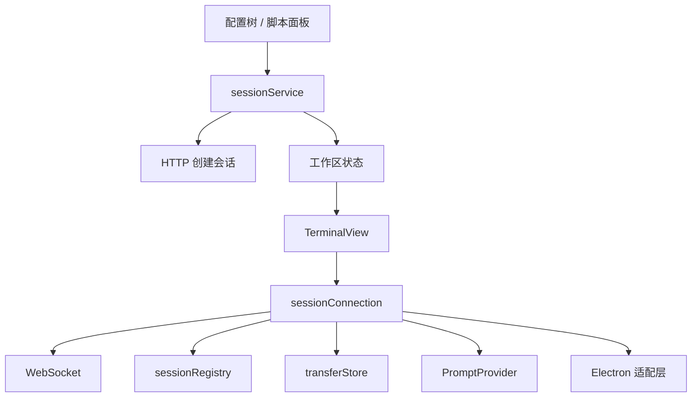

# 前端架构

前端以功能模块组织。页面入口负责组合各功能，界面组件通过服务执行操作，布局与传输数据各有独立的状态所有者。

```text
src/
├── pages/Session/                # 主窗口、独立窗口和页面外壳
├── features/
│   ├── AppProviders.tsx          # 组合各功能 Provider
│   ├── workspace/                # 布局树、活动会话、分屏和拖拽
│   ├── terminal/components/      # xterm 渲染、搜索、焦点、尺寸
│   ├── sessions/                 # 会话类型、运行时注册表、连接与命令服务
│   ├── catalog/                  # 配置树、会话编辑表单、配置 CRUD
│   ├── transfers/                # 按会话订阅的目录/进度、上传下载
│   ├── scripts/                  # 脚本目录、编辑与执行入口
│   ├── settings/                 # 工作空间变量、全局变量、命名空间和外壳偏好
│   └── dialogs/                  # 脚本与页面共用的输入弹窗
├── platform/
│   ├── backend.ts               # 后端地址与 HTTP 请求
│   └── electronBridge.ts        # 有类型的 IPC、窗口和文件接口
└── shared/                      # 通用组件、字符串、路径和 ID 工具
```

## 状态归属

| 状态 | 所有者 | 更新范围 |
| --- | --- | --- |
| 会话列表、布局树、焦点、最大化 | `WorkspaceProvider` | 工作区数据消费者 |
| 活动会话 | 从工作区焦点组推导 | 无额外同步副本 |
| 侧边栏宽度、选中功能 | `ShellProvider` | 外壳消费者 |
| 会话配置树 | `CatalogProvider` | 配置树与脚本归属选择器 |
| 变量配置 | `SettingsProvider` | 设置界面 |
| 脚本目录 | `ScriptsProvider` | 脚本界面 |
| 输入弹窗 | `PromptProvider` | 弹窗自身 |
| 远程目录、传输进度 | `transferStore` | 指定会话的指定数据频道 |

工作区的操作入口与状态分开提供。终端读取稳定的操作入口，更新其他会话或切换焦点时不会重新建立连接。

传输数据使用 `files`、`progress` 两类订阅。A 会话上传进度变化只通知 A 的进度消费者，不通知 A 的目录、B 会话、工作区或终端。

分屏布局仅驻留当前窗口内存，不写入本地存储。新窗口、重启、关闭全部会话后均从单屏开始。

## 会话与连接



- `TerminalView` 管理 xterm 实例、插件、搜索、可见性、尺寸与焦点。仅在真实卸载时销毁终端。
- `sessionConnection` 管理 WebSocket、解码、协议分发、脚本回调、日志与订阅清理。连接跟随会话生命周期，不跟随分屏坐标变化。
- 每个连接拥有自己的请求回调表和取消信号。关闭时清空回调、移除终端订阅，并取消脚本创建会话后的等待任务。
- `sessionRegistry` 封装运行时与配置文件名索引。旧连接清理时校验所有权，不会移除同 ID 的新连接。
- `sessionService` 提供创建、关闭、发送命令、脚本执行、列文件、上传、查询工作目录、拖出窗口等接口。页面不直接读取 socket。
- 窗口内移动标签只改变布局。拖出窗口时发送现有 `detach` 协议，后端保留 SSH worker，新窗口接管同一会话 ID，并回放终端快照。

## 配置与界面边界

会话目录分为三部分：

- `SessionTree`：树节点、双击、右键与拖放事件。
- `SessionEditor`：会话字段、登录脚本与表单页签。
- `SessionCatalog`：组合树和编辑弹窗，通过 `catalogService` 执行配置操作。

设置、脚本和会话配置各有独立服务。HTTP 参数与响应类型放在服务/模型中，Electron 通道与参数放在 `electronBridge` 中。领域数据类型不从组件目录导入。

`features` 不依赖 `pages`。会话/配置/传输服务不依赖 React 或界面组件，可在 Node.js 中独立测试。遗留页面仍可通过 `util.request` 使用统一的后端适配层。

## 验证

```bash
npm run test:workspace          # 布局变换、嵌套分屏、焦点、关闭和触发范围
npm run test:session            # 状态订阅隔离、连接所有权、取消、回调与协议
npm run test:workspace:browser  # 真实 xterm + 模拟 WebSocket 的交互回归
npm run test:app:browser        # 构建后验证完整页面、配置编辑、设置、传输与独立窗口
npm run test:frontend           # 顺序执行以上全部检查
npm run tsc:frontend            # 当前 SSH 客户端前端模块的严格类型检查
npm run tsc                    # 全仓库类型检查
```

浏览器测试使用隔离的模拟后端，不连接真实 SSH 服务器。macOS 默认使用 Chrome，其他环境可通过 `CHROME_PATH` 指定浏览器。测试需要 Node.js 18 或更高版本。
